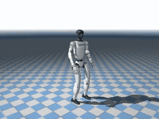
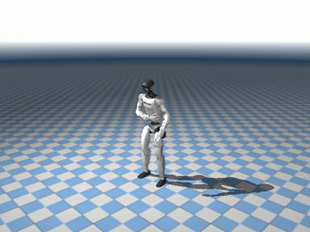
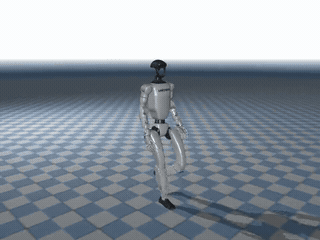
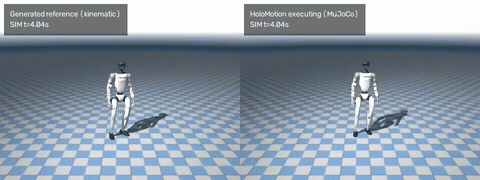
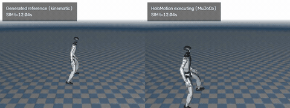

<div align="center">
  <h1>OMG-Flow</h1>
  <p>Native 50 Hz · Flow Matching · Synchronous 0.2 s Replanning</p>
  <p>Built on <a href="https://github.com/KunYing-Lee/OMG-Lite">OMG-Lite</a> and
  <a href="https://github.com/Tsinghua-MARS-Lab/OMG">OMG</a>.</p>
  <p>
    <a href="docs/flow-method.md"></a>
    <a href="deployment/README.md"></a>
    <a href="https://huggingface.co/datasets/bones-studio/seed"></a>
  </p>
</div>

Text-conditioned Unitree G1 motion in a **38D pose space**, continuing a clean
committed prefix with flow matching and native **50 Hz** control.

<table>
  <tr>
    <td align="center" width="33%"><a href="docs/media/flow/dance.mp4"></a><br>Small steps and gestures</td>
    <td align="center" width="33%"><a href="docs/media/flow/turn.mp4"></a><br>Repeated turns</td>
    <td align="center" width="33%"><a href="docs/media/flow/wave_arms.mp4"></a><br>Raise and wave arms</td>
  </tr>
  <tr>
    <td align="center" width="33%"><a href="docs/media/flow/kick.mp4"></a><br>Low kicks and steps</td>
    <td align="center" width="33%"><a href="docs/media/flow/walking_forward.mp4"></a><br>Walk forward</td>
    <td align="center" width="33%"><a href="docs/media/flow/spin.mp4"></a><br>Spin around</td>
  </tr>
  <tr>
    <td align="center" width="33%"><a href="docs/media/flow/side_step.mp4"></a><br>Side steps</td>
    <td align="center" width="33%"><a href="docs/media/flow/crouch_rebound.mp4"></a><br>Crouch and rebound</td>
  </tr>
</table>

HoloMotion execution in MuJoCo. Click a preview for the full 20-second video.
[Prompts and provenance](docs/media/flow/README.md).

## 1. Install

```bash
git clone https://github.com/KunYing-Lee/OMG-Flow.git
cd OMG-Flow
make venv
source .venv/bin/activate
make install
export PYTHONPATH=src
```

Use `make install-cn` for China mainland networks. RTX 5090:
`make venv VENV_PYTHON=3.11` then `make install-blackwell`.
See [environment details](docs/flow-method.md#install).

## 2. Prepare BONES-SEED

Obtain [BONES-SEED](https://huggingface.co/datasets/bones-studio/seed) under its
[license](https://bones.studio/info/seed-license), plus the
[pinned T5-base snapshot](https://huggingface.co/google-t5/t5-base/tree/a9723ea7f1b39c1eae772870f3b547bf6ef7e6c1).

```bash
python -m omg.data.bones_prepare --archive data/source/g1.tar.gz \
  --metadata data/source/seed_metadata_v004.parquet --root data/bones
python -m omg.cli.data.bones_stats --data data/bones
python -m omg.cli.data.cache_bones_text --data data/bones \
  --output data/bones-text --t5 /models/t5-base --device cuda
```

See [data preparation](docs/data/bones.md). Dataset and model weights are downloaded separately.

## 3. Train

```bash
export FLOW_DATA="$PWD/data/bones"
export FLOW_TEXT_CACHE="$PWD/data/bones-text"
export FLOW_OUTPUT="$PWD/runs/bones-flow"
make smoke
make train TRAIN_ARGS=--resume
```

The [four-GPU preset](configs/flow/bones.yaml) uses ten history frames, a
100-frame horizon and suffix-only loss. See [training](docs/flow-method.md#validate-and-train).

## 4. Deploy and Simulate

Install `pip install -e '.[train,tracking,export,render]'` and set your Flow
checkpoint, T5-base and [HoloMotion v1.4.1](https://github.com/HorizonRobotics/HoloMotion)
paths in [deployment/sync_flow.json](deployment/sync_flow.json).

```bash
nvidia-smi  # Choose an idle GPU.
CUDA_VISIBLE_DEVICES=0 make deploy \
  DEPLOY_ARGS='--prompt "A person walks forward." --seed 1234 --duration 20'
```

The default is synchronous 0.2 s replanning, TensorRT FP16 Euler-10, P25 and
an 8 Hz suffix filter. Runs save trajectories, timing reports and paired videos
under `outputs/`. See [deployment](deployment/README.md) and [the control contract](deployment/SYNC.md).

## Acknowledgements

Based on [OMG](https://github.com/Tsinghua-MARS-Lab/OMG) and
[OMG-Lite](https://github.com/KunYing-Lee/OMG-Lite), with tracking from
[HoloMotion](https://github.com/HorizonRobotics/HoloMotion) and clean-prefix
training inspired by [HALO](https://apple-aiml-research.github.io/ml-halo/).

Training data includes Motion Data by [Bones Studio](https://bones.studio/).
Use of the underlying dataset is subject to the BONES Motion Capture Dataset License Agreement.

[MIT License](LICENSE) · [Third-party notices](THIRD_PARTY_NOTICES.md)
