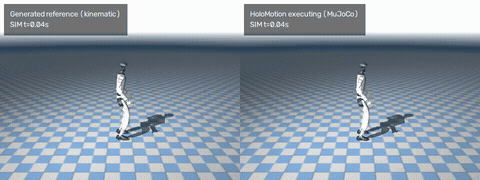
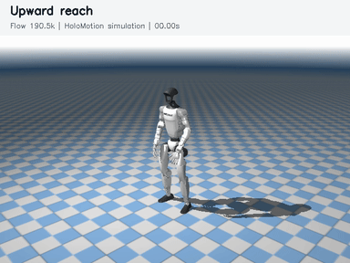
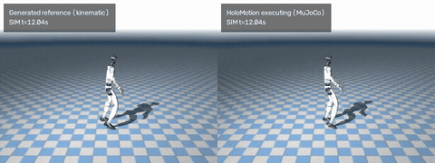
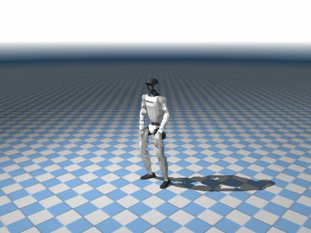
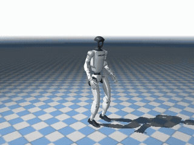

<div align="center">
  <h1>OMG-Flow</h1>
  <p>50 Hz Control · Synchronous 0.2 s Replanning · Flow Matching</p>
  <p>
    Built on <a href="https://github.com/KunYing-Lee/OMG-Lite">OMG-Lite</a> and
    <a href="https://github.com/Tsinghua-MARS-Lab/OMG">OMG: Omni-Modal Motion Generation for Generalist Humanoid Control</a>.
  </p>
  <p>
    <a href="https://github.com/KunYing-Lee/OMG-Lite"></a>
    <a href="https://huggingface.co/datasets/bones-studio/seed"></a>
    <a href="docs/flow-method.md"></a>
    <a href="docs/flow-long-eval.md"></a>
  </p>
</div>

OMG-Flow generates text-conditioned Unitree G1 motion at **native 50 Hz**
in a **38D pose space**, using flow matching to continue an already committed reference.

- **Flow matching:** learn a velocity field and generate motion with a deterministic Euler solver.
- **Clean committed prefix:** preserve the frames already exposed to the tracker and generate only the editable suffix.
- **Default controller:** synchronous 0.2 s replanning, TensorRT FP16 Euler-10, and an 8 Hz suffix low-pass.
- **BONES-SEED training:** actor-separated data, train-only normalization, and frozen T5-base text embeddings.

<table>
  <tr>
    <td align="center" width="33%"><a href="docs/media/flow/dance.mp4"></a><br>Dance choreography</td>
    <td align="center" width="33%"><a href="docs/media/flow/turn.mp4"></a><br>Repeated turns</td>
    <td align="center" width="33%"><a href="docs/media/flow/jump.mp4"></a><br>Upward reach</td>
  </tr>
  <tr>
    <td align="center" width="33%"><a href="docs/media/flow/energetic_dance.mp4"></a><br>Energetic dance</td>
    <td align="center" width="33%"><a href="docs/media/flow/run.mp4"></a><br>Backward movement</td>
    <td align="center" width="33%"><a href="docs/media/flow/crouch_rebound.mp4"></a><br>Crouch and rebound</td>
  </tr>
</table>

## 1. Install

```bash
git clone https://github.com/KunYing-Lee/OMG-Flow.git
cd OMG-Flow
make venv
source .venv/bin/activate
make install
export PYTHONPATH=src
```

Use `make install-cn` for China mainland networks. For RTX 5090 training,
create the environment with `make venv VENV_PYTHON=3.11` and use
`make install-blackwell` instead of `make install` (PyTorch 2.8 / CUDA 12.8).
See [environment details](docs/flow-method.md#install).

## 2. Prepare BONES-SEED

Obtain the official G1 archive and v004 metadata from
[BONES-SEED](https://huggingface.co/datasets/bones-studio/seed), and the
[pinned T5-base snapshot](https://huggingface.co/google-t5/t5-base/tree/a9723ea7f1b39c1eae772870f3b547bf6ef7e6c1).

```bash
python -m omg.data.bones_prepare --archive /data/source/g1.tar.gz \
  --metadata /data/source/seed_metadata_v004.parquet --root /data/bones
python -m omg.cli.data.bones_stats --data /data/bones
python -m omg.cli.data.cache_bones_text --data /data/bones \
  --output /data/bones-text --t5 /models/t5-base --device cuda
```

Conversion produces native 50 Hz clips with actor-separated train, validation and
test splits. See [data provenance](docs/data/bones.md) and
[preparation details](docs/flow-method.md#prepare-bones-seed).

## 3. Train

```bash
export FLOW_DATA=/data/bones
export FLOW_TEXT_CACHE=/data/bones-text
export FLOW_OUTPUT=/runs/bones-flow
make smoke
make train TRAIN_ARGS='--resume --stop-after 16'
make train TRAIN_ARGS=--resume
```

The default uses four GPUs, ten history frames and a 100-frame future window.
Each example samples a committed-prefix length from 0–50; that prefix stays
clean and masked, and only the suffix contributes to flow-matching loss.
The [preset](configs/flow/bones.yaml) runs for 200k updates.

Checkpoints include weights, optimizer, normalization and data provenance.
**The current trainer retains only rolling `latest.pt` and validation-loss
`best.pt`; it does not archive every step.** See
[training details](docs/flow-method.md#validate-and-train) and
[validation evidence](docs/flow-validation.md).

## 4. Deploy and Simulate (Default)

Use a checkpoint produced by the Flow trainer. Flow weights are not bundled;
upstream diffusion checkpoints are incompatible. Install CUDA inference dependencies
with `pip install -e '.[train,tracking,export,render]'`, then set the checkpoint,
local T5-base and HoloMotion v1.4.1 paths in
[deployment/sync_flow.json](deployment/sync_flow.json).

```bash
# Check processes and choose one idle GPU.
nvidia-smi
CUDA_VISIBLE_DEVICES=0 make deploy
# Change only the prompt/seed/duration:
CUDA_VISIBLE_DEVICES=0 make deploy \
  DEPLOY_ARGS='--prompt "A person walks forward." --seed 1234 --duration 20'
```

The default runs **read state → synchronous Flow replan → HoloMotion tracker →
physics/write** in one thread at 50 Hz, replanning every ten ticks (0.2 s).
It preserves a 25-frame committed prefix and applies the 8 Hz low-pass only to
the new suffix. TensorRT FP16 uses ten Euler steps; engine creation and warmup
finish before the control epoch. There is no asynchronous planner/server path.

Each run saves a two-panel MP4 (**generated reference | sim execution**), raw
NPZ trajectories and JSON timing/failure diagnostics under `outputs/sync.*`.
`make export-sync` prebuilds the engine. `make showcase SHOWCASE_ARGS='--gpu 0'`
regenerates the fixed [media cases](docs/media/flow/cases.json), monitoring the
selected GPU and stopping if another process appears.

Simulation waits during compute overruns; video playback uses simulation time.
Deadline misses remain in the reports. The physical `RobotSDK` binding is still
unimplemented. See [deployment setup](deployment/README.md) and
[the full timing/filter contract](deployment/SYNC.md).

## 5. Offline Generation and Evaluation

For a programmatic continuation:

```python
from omg.generation.flow_reference import FlowReferenceGenerator

generator = FlowReferenceGenerator.from_checkpoint("/runs/bones-flow/best.pt", device="cuda")
suffix = generator.generate_suffix(
    history_qpos, committed_qpos, gaussian_noise,
    steps=10, text_tokens=t5_tokens, text_mask=t5_mask,
)
```

Inputs are world-space G1 poses `[B, T, 36]`: xyz, wxyz and 29 joint angles.
Use ten history frames, explicit noise `[B, 100, 38]` and cached T5 tokens.
With P25, this lower-level API returns 75 new poses; the deployment controller
adds scheduling, the configured suffix filter and tracker execution.

The [historical long evaluation](docs/flow-long-eval.md) compares checkpoints
using fixed dataset histories and offline reference replay. Its old survival
results do not describe the standing-start synchronous gallery above.
Training/data and offline diffusion benchmark tools remain available; see
[the method](docs/flow-method.md) and [benchmark protocol](docs/benchmark.md).

## Acknowledgements

Based on [OMG](https://github.com/Tsinghua-MARS-Lab/OMG) and
[OMG-Lite](https://github.com/KunYing-Lee/OMG-Lite), with motion data from
[BONES-SEED](https://huggingface.co/datasets/bones-studio/seed), tracking from
[HoloMotion](https://github.com/HorizonRobotics/HoloMotion), and clean-prefix
training inspired by [HALO](https://apple-aiml-research.github.io/ml-halo/).

[MIT License](LICENSE)
